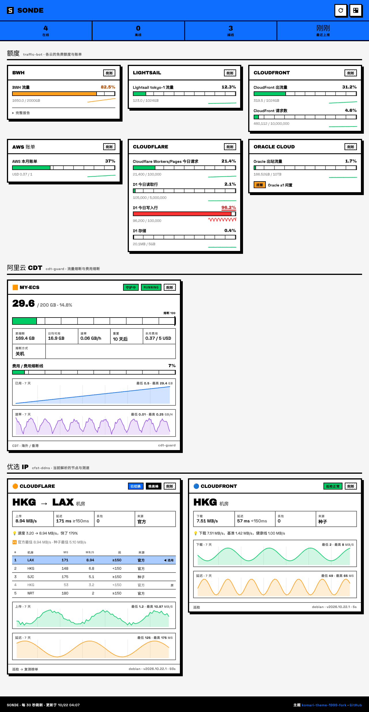

# Sonde

像探针一样展示几个自用工具上报的状态：**traffic-bot**（各云免费额度与账单）、**cdt-guard**（阿里云 CDT 流量 / 费用熔断）、**cfst-ddns**（优选 IP 的机房与测速）。主题沿用 [komari-theme-1999-fork](https://github.com/10ta/komari-theme-1999-fork)。



- 卡片统一为「厂商 · 名称」（Cloudflare · D1、AWS · CloudFront、AlibabaCloud · CDT…），cdt-guard 的阿里云 CDT 也是同一种样式。每张额度卡片按同一个顺序分三层：
  - **指标**：有额度的量，一条一行：额度条（越线变色、熔断线标记）+ 右边 7 根小柱「近 7 天每天用了多少」。按月累计的额度看当天增加了多少，虚线是均匀用完额度时每天该用的量；按天重置的用量（D1 读写、Workers 请求）和存储大小看当天的最高值，虚线是上限。柱子超过虚线变橙色，没有数据的那天画斜纹，今天的柱子半透明（还没过完）。悬停看具体数值；按 UTC 日期分天
  - **明细**（引用块样式，只有这一层用）：组成上面那些数的各部分，每个站点、每个数据库、账单里的每项服务、各 Worker、各地域
  - **状态**：重置时间、日均可用、数据时间、提示
  - 每项一行，放不下显示省略号，点一下展开
- 所有卡片（额度和优选 IP）进同一个瀑布流：列宽不小于 360px，页面越宽列越多，卡片不会被拉宽；每张卡放进当前最矮的一列，同一厂商的几张（Cloudflare 的 CDN / D1 / Workers）尽量排在同一列。没有实例的来源（比如 Lightsail 没开机器、R2 没有存储桶）不显示
- 优选 IP 卡片：机房、测速、榜单（固定 5 行）、7 天曲线（悬停看每小时的值）
- 页面每 30 秒读一次最新数据（切回页面时立即补读）。数据是各工具上次上报的结果，页面不能让工具重新测速，所以没有「刷新」按钮
- 来源超过两个上报周期没动静就标成**离线**（比如 cdt-guard 停了，一眼能看到）
- 19 套配色（与 1999 主题相同），手机可用；可以部署在子路径下

## 怎么工作

```
cdt-guard ─┐   每次运行后 POST 一份 JSON
traffic-bot├────────────────────────────▶  Worker  /ingest  ──▶  D1（每个来源最新一份 + 8 天每小时历史）
cfst-ddns ─┘   带上报密钥；失败只记日志               │
                                                      ▼
                  CF Pages 页面 ┐                /api/status、/api/history
                  Vercel 页面   ┘── 同一份纯静态网页 ──┘
```

- **上报内容已脱敏**，和这几个工具的 Telegram 消息同一套规则：没有 IP、域名、网址、实例 ID（cfst 的 IP 换成机房代码，种子来源只写「种子」）。所以页面是**公开**的，不需要登录。
- **存储用 D1 不用 KV**：KV 免费版每天只能写 1000 次，cdt-guard（5 分钟一次）和 traffic-bot（10 分钟一次）加起来就接近上限；D1 每天可写 10 万行。
- **不用 cron**：过期历史在写入时顺带清理，不占 Cloudflare 账户的免费 cron 名额。
- 网页没有构建步骤，`web/` 目录原样发布。

```
web/      纯静态页面（index.html / app.js / app.css / theme.css / config.js）
worker/   Worker（src/index.js）+ D1 表结构（migrations/）
init.sh   首次部署 / 换地址 / 换密钥
update.sh 日常更新（和其他项目同一套约定）
```

## 部署

需要：Node.js 20+、`git`、`curl`，一个 Cloudflare 账号。在你自己的电脑或 Debian 服务器上操作都可以（以后更新也在同一台机器上）。

> ⚠️ **影响范围**：会在 Cloudflare 账户里新建一个 Worker（`sonde`）和一个 D1 数据库（`sonde`）。请求计入账户共享的每日 10 万次 Worker 请求额度——三个工具每天合计几百次上报，加上打开网页时每 30 秒一次读取。

### 1. 部署 API（Worker + D1）

```bash
git clone https://github.com/10ta/Sonde.git && cd Sonde
./init.sh
```

脚本会问：是否继续 → Cloudflare 登录方式（浏览器 / API token），其余全自动：建 D1 并建表、部署 Worker、生成上报密钥、把 API 地址写进 `web/config.js`，最后自检。

- **没有浏览器的服务器**：在 [My Profile → API Tokens](https://dash.cloudflare.com/profile/api-tokens) → Create Token → 模板 **Edit Cloudflare Workers** → 权限里**再加一行 Account · D1 · Edit** → 创建，脚本里选 2 粘贴。
- 配置保存在仓库根目录的 `.sonde.env`（权限 600、已在 `.gitignore` 里），**上报密钥 `INGEST_TOKEN` 也在里面**。
- 跑完按提示把 `worker/wrangler.toml`（database_id）和 `web/config.js`（API 地址）提交推送，这两个都不是机密：

```bash
git add worker/wrangler.toml web/config.js && git commit -m "config: deploy" && git push
```

**建议给 API 绑自己的域名**（`*.workers.dev` 在国内访问不稳定）：控制台 Workers & Pages → `sonde` → Settings → Domains & Routes → Add → Custom domain，比如 `sonde-api.example.com`，然后：

```bash
./init.sh --url https://sonde-api.example.com
```

### 2. 部署网页

同一份代码可以同时部署到 Cloudflare Pages 和 Vercel，每次推送都会自动重新部署。

> ⚠️ 连接 GitHub 时，平台会请求安装它们的 GitHub App。授权页选 **Only select repositories**，只勾这个仓库。

**Cloudflare Pages**：Workers & Pages → Create → **Pages** → Connect to Git → 选本仓库 → Begin setup：

| 项目 | 填写 |
|---|---|
| Production branch | `main` |
| Framework preset | None |
| Build command | 留空 |
| Build output directory | `web` |

**Vercel**：Add New… → Project → 导入本仓库 → Configure Project：

| 项目 | 填写 |
|---|---|
| Framework Preset | Other |
| Root Directory | `web`（点 Edit 选择） |
| Build Command / Output Directory | 都留空 |

部署完打开网址，应该看到「还没有任何上报」。两边都可以在设置里绑自己的域名。

- **子路径**：页面全部用相对路径，放在 `https://example.com/sonde/` 之类的子路径下也能用（比如用自己服务器的 Caddy 托管 `web/` 目录）。
- 临时换 API：网址后加 `?api=https://...`。

### 3. 接入三个工具

这三个工具在 [scripts-de-moi](https://github.com/10ta/scripts-de-moi) 里，上报功能默认关闭。把 `./init.sh` 最后打印的两行加进各自的配置文件：

```bash
SONDE_URL=https://sonde-api.example.com
SONDE_TOKEN=<.sonde.env 里的 INGEST_TOKEN>
```

| 工具 | 配置文件 | 生效 | 上报时机 |
|---|---|---|---|
| traffic-bot | `/etc/traffic-bot.env` | `systemctl restart traffic-bot` | 启动 15 秒后一次；之后每次告警检查（默认 10 分钟）、`/check`、定时播报 |
| cdt-guard | `/etc/cdt-guard.env` | 下一次检查（5 分钟内） | 每次检查 |
| cfst-ddns | `/etc/cfst-ddns.env` | 下一次测速 | 每次真正测速后（不到时间的空转不报）；巡检只测当前 IP，卡片沿用上次复测 / 全量扫描的榜单 |

先把三个工具更新到带上报功能的版本：在 scripts-de-moi 里 `sudo ./update.sh`。上报失败（网络不通、密钥不对）只会在日志里留一行警告，不影响它们本来的工作。

装了 cdt-guard 时，traffic-bot 卡片里的「Aliyun CDT」会被隐藏，以 cdt-guard 自己那张更详细的卡片为准。

## 更新

```bash
./update.sh            # 同步代码 → 重新部署 Worker、迁移数据库 → 提交生成的配置 → 推送（网页自动部署）
./update.sh --status   # 只看版本、API 是否在线、各来源最近一次上报
```

和其他项目的 `update.sh` 规则相同：有未提交的改动或本地和远端分叉时直接退出，不提问。

**换上报密钥**：`./init.sh --new-token`，然后把三个工具配置里的 `SONDE_TOKEN` 都改掉（旧密钥立即失效）。

**删掉不再用的来源**（比如 cfst-ddns 去掉了一个目标）：

```bash
source .sonde.env
curl -X DELETE "$PUBLIC_URL/ingest/cfst-ddns:fastly" -H "Authorization: Bearer $INGEST_TOKEN"   # 没绑域名就用 $WORKER_URL
```

## API

| 方法 | 路径 | 说明 |
|---|---|---|
| `POST` | `/ingest` | 上报，需要 `Authorization: Bearer <INGEST_TOKEN>`。body：`{"source", "ts", "interval", "data", "series"}`，最大 64 KB |
| `DELETE` | `/ingest/<source>` | 删除一个来源的最新状态和历史，需要密钥 |
| `GET` | `/api/status` | 每个来源最新的一份，公开 |
| `GET` | `/api/history` | 近 8 天每小时的指标值（`series` 里的数字），公开，边缘缓存 5 分钟。多留的 1 天给「近 7 天每天的用量」的第一天当起点 |

- `source`：小写字母、数字和 `:_-`，如 `traffic-bot`、`cdt-guard`、`cfst-ddns:cloudflare`
- `interval`：上报方声明的上报间隔（秒），超过两倍间隔加 2 分钟没收到新的就算离线
- `series`：`{指标名: 数值}`，每小时只留最后一个值，用来画曲线和每天的用量
- 网页按 `source` 识别卡片类型；不认识的来源会出现在「其他」里，显示原始 JSON

## 本地开发

```bash
cd worker && npm install
echo 'INGEST_TOKEN=test' > .dev.vars
npx wrangler d1 migrations apply sonde --local
npx wrangler dev                                  # http://127.0.0.1:8787
cd ../web && python3 -m http.server 8080          # 打开 http://127.0.0.1:8080/?api=http://127.0.0.1:8787
```

## 许可

配色与基础样式来自 [komari-theme-1999-fork](https://github.com/10ta/komari-theme-1999-fork)（MIT），字体见 [web/vendor/LICENSES.md](web/vendor/LICENSES.md)。
